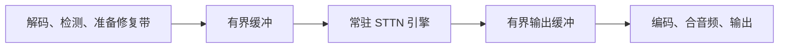

# STTN 自建 Serving 评估与优化路线

整理日期：2026-10-31。代码参考：`0f6992f`。

硬件更正：首次用户提供的 GPU 基准识别到 `NVIDIA RTX5880-Ada-24Q`，用户确认后续使用的就是这台机器，先前“5090”的记忆不准确。后续性能工作以该环境为准；下文 5090 / DGX Spark 规格比较仅保留作采购参考，不能用来解释本次实测。详见[首次 GPU 基线分析](06-STTN首次GPU基线分析.md)。

本文记录自建去字幕服务的业务背景、技术判断和候选优化路线，供后续评估、实验和采购讨论使用。批量预处理已完成 GPU A/B，真实样片已有纯 STTN 与补修路径的实测；这些结果不代表已经部署服务或批准了采购和迁移。

## 1. 已确认的背景和目标

| 项目 | 当前情况 |
| --- | --- |
| 生产处理方式 | 目前全部使用 Kaipai API，自建 STTN 尚未替代生产流量 |
| 自建动机 | 据用户反馈，Kaipai 将涨价 60 倍；具体单价和计费口径尚未记录 |
| 现有 STTN 画质 | 用户判断与 Kaipai 有不太明显的差距，已经优于市面上其他产品，可以先考虑效率；本次真实样片关闭 ProPainter 补修后也可以接受 |
| 优化优先级 | 以当前 STTN 输出为画质基线，优先提高执行效率、降低单位处理成本 |
| 首批硬件 | 实测设备名为 `NVIDIA RTX5880-Ada-24Q`；先前记作 5090，已更正。物理 GPU、虚拟化配置、CPU、内存和驱动待核实 |
| 潜在采购 | 老板在考虑 DGX Spark，尚无采购决定 |
| 业务规模 | 未来总使用量尚不好预估，不能据此确定所需机器数量和回本周期 |
| 排除项 | LAMA 固定 CPU 是有意设计，本轮不讨论、不改造 LAMA 路径 |

“做到极致”的业务含义是：在画质可接受、时延可接受的前提下，降低每分钟合格成片的总成本。Kaipai 涨价 60 倍，不意味着 STTN 必须加速 60 倍；需要先测自建的成本基线，再与 API 新价格比较。

## 2. 当前判断

1. 优先用当前 `RTX5880-Ada-24Q` 环境验证并优化 STTN，不直接接入 DeepInfer。
2. 第一阶段保持现有模型权重、参考帧选择、滑窗和融合语义；实现调整仍需检查数值及成片差异。
3. 工程优化有结果后，再决定是否减少时序计算、调整模型或训练蒸馏模型。
4. DGX Spark 暂不作为本业务提速的优先采购项。需要相同 STTN 负载的实测证据，不能用统一内存容量或 FP4 宣传算力推断 FP16 视频修复吞吐。
5. 先得到单卡能力和成本曲线，再结合逐渐明确的业务流量决定扩容和迁移。

最新样片以纯 STTN + GDINO 作为后续优化基线：关闭 ProPainter 补修后，用户认为画质可以接受，记录的流水线耗时从 `601.892 s` 降至 `115.609 s`，约快 `5.21×`。这是两条处理路径的实测对比，不是预处理改动的加速比，也不能外推到所有素材。当前无需把 ProPainter 补修列为常规必经步骤；需要额外画质收益的素材再单独评估。

上述路线与采购判断仍是建议；实测范围和计时口径见[首次 GPU 基线分析](06-STTN首次GPU基线分析.md)第 9 节。

## 3. DeepInfer 的适配结论

本次读取的 [DeepInfer README 快照](https://github.com/deepseek-ai/DeepInfer/blob/553741557a57df44a46fb3ab72b6aafeaf945337/README.md)声明：

- 支持模型为 DeepSeek-V4.1-Flash。
- 支持 NVIDIA SM100 GPU 和 Huawei Ascend 950 NPU。
- 开源版本提供离线推理核心；完整服务还需要 KV cache 系统、阶段分离部署及副本负载均衡等设施。
- 优化主要围绕 MLA、MoE、推测解码、token 调度和模型专用算子。

当前 STTN 是卷积与视频 patch attention 混合网络，没有自回归 token 解码过程，也不属于其已支持的模型架构。RTX 5090 的计算能力为 12.0，DGX Spark 的 GB10 为 12.1，均不能因为同属 Blackwell 就视为 SM100。

因此，没有可以直接承载当前 STTN 的现成适配路径。可借鉴的是 CPU/GPU 工作重叠、按负载调度、缓存和执行图复用等思路；移植 DeepInfer 的模型运行时并非当前优先路线。支持范围未来可能变化，应以届时官方说明为准。

## 4. 当前 STTN 已有能力与计算特征

### 4.1 已经存在的优化

- CUDA 默认 FP16 autocast；模型权重仍以 FP32 加载。
- FP16 算子不兼容或非有限输出时，丢弃当前修复带结果并以 FP32 重跑；OOM 不走该回退。
- 同一修复带内缓存 encoder 输出，并缓存首个 Transformer block 的 Q/K/V 投影。
- ROI 和修复带裁剪，模型空间输入固定为 `432×240`。
- 分阶段性能日志和缓存开关对照基准。
- CPU 预处理批量张量化，去除逐帧 PIL 往返；已通过本地数值回归，目标 GPU 合成修复带 A/B 耗时下降约 15.7%、输出像素差为 0，见[首次 GPU 基线分析](06-STTN首次GPU基线分析.md)。

详细口径见 [STTN 性能分析](03-STTN性能分析.md)和[首层 Q/K/V 缓存设计](../superpowers/specs/2026-09-18-sttn-first-layer-qkv-cache-design.md)。设计文档含有历史状态，当前实际行为以代码为准。

### 4.2 滑窗存在必要的重复计算

对恰好 50 帧的修复带，使用默认 `neighbor_stride=5`、参考帧采样间隔 `10`：

| 指标 | 静态计算结果 |
| --- | ---: |
| 窗口数 | 10 |
| Transformer 累计输入帧次 | 140 |
| Decoder 累计输出帧次 | 104 |
| 首层 Q/K/V 的整带 FP16 缓存张量 | 约 0.46 GiB |

这些数字不是 GPU 耗时。实际流水线会加入上下文帧、按切景或字幕段结束刷新，一个视频段还可能生成多个修复带，实际工作量会变化。

同一帧在不同窗口中有不同上下文，后续层特征和最终预测也会不同，不能将后七层或最终结果直接跨窗口复用。每帧只解码一次会改变当前重叠融合语义，属于需要画质评估的算法调整。

### 4.3 不能假设 Flash Attention 可以直接使用

STTN 将 patch 内的像素和通道展平成注意力向量。标准输入下 encoder 特征为 `108×60`，四路各 64 通道：

| Patch | 每帧 token 数 | 注意力向量维度 |
| --- | ---: | ---: |
| 108×60 | 1 | 414,720 |
| 36×20 | 9 | 46,080 |
| 18×10 | 36 | 11,520 |
| 9×5 | 144 | 2,880 |

这与常见 LLM 的 head dimension 相差很大。改用 PyTorch SDPA 不保证进入 Flash Attention 后端，更不能直接套用 FlashMLA。应验证后端实际选择及耗时。

每层还有 Q/K/V 的 `1×1` 卷积、attention 输出卷积和两层 FFN 卷积。理论运算量显示卷积不可忽略，但卷积与注意力谁占主要时间，需要目标 GPU 的算子 profile 证实。

## 5. 第一阶段：优先保持现有输出语义

下面按建议验证顺序列出候选项。尚未实施，不预先承诺收益。

| 候选项 | 源码依据与预期作用 | 验证重点 |
| --- | --- | --- |
| 删除未使用的 attention mask 计算 | 当前每路构造并 `repeat` 得到 `mm`，但 `Attention.forward` 未读取参数 `m` | 输出等价、显存分配和耗时；不要顺手引入新的注意力 mask 语义 |
| 合并窗口级数值检查 | 当前每窗口两次 `.item()`，要求 GPU 结果返回 CPU | 保留非有限值检测和整带 FP32 回退，测同步是否是瓶颈 |
| GPU 内完成结果合成与重叠混合 | 当前每窗口 `.cpu()`，再用 NumPy 转像素、合成和混合 | 保持取整位置、类型、颜色空间及混合顺序，控制峰值显存 |
| 跳过不需要输出的干净帧解码 | 上下文参与时序推理，但干净帧最终保留原图；decoder 本身逐帧计算 | 保留其参考作用，确认目标帧输出及异常检查约定 |
| 编译模型子图 | 分别评估 encoder、单窗口 Transformer、decoder 的 `torch.compile` | 首次编译成本、实际形状数量、重编译、数值与稳态吞吐 |
| 评估卷积内存布局 | 对照 `channels_last` 等布局及适用的卷积实现 | 包含布局转换成本，确认 attention reshape 没有抵消收益 |
| 常驻模型、复用缓冲 | 避免每任务加载和频繁临时分配 | 冷启动、显存上界、连续任务及异常恢复 |

无用 `mm` 的量级：上述 50 帧配置下，仅八层 `repeat` 的 bool 输出累计约 0.33 GiB。它是静态累计张量写入量，不等于真实 DRAM 流量、峰值占用或可预测的加速幅度。

数值检查应考虑在 GPU 累积异常标记、到整带结束统一处理；不能直接删除异常保护。实现时需要确认更早发生的异常如何传播和重跑。

GPU 合成也不是简单将 NumPy 换成 Torch：当前先转 uint8、按 mask 合成，再依次混合窗口结果。改变取整或混合顺序可能改变像素。

### 进一步的执行优化候选

- **融合三个 Q/K/V 投影卷积。** 拼接权重后做一次 `1×1` 卷积再拆输出；数学上等价，但需比较数值、缓存适配、内存和真实耗时。
- **最后一个 Transformer block 只计算目标帧输出。** K/V 仍覆盖全部窗口，Q、输出卷积和 FFN 可探索只算最终需要解码的帧。前七层仍需保留参考帧更新，不能照此全部裁剪。
- **按实际窗口形状分桶。** 预热并复用编译结果；避免无边界地缓存所有形状。不能随意补零或复制参考帧凑长度，否则会改变 softmax。
- **重新对照 Q/K/V 缓存开关。** 已开启不代表在所有批量和负载下都更快；必须计入缓存构建、索引和显存成本。

这些变换均需验证，数学等价也不代表不同 CUDA kernel 下逐位一致。

## 6. Serving 方向：让现有 GPU 持续工作

建议从每 GPU 一个常驻 STTN 引擎起步，将 CPU 前后处理与 GPU 推理重叠：



处理视频 A 的 STTN 时，CPU 可准备视频 B，或编码已完成的结果。缓冲必须有界，防止整帧视频在内存中无限积压。

引擎内再对照 batch=1、2、4 等配置，按窗口形状和显存预算调度，并给等待批量设置时限。不同视频必须沿独立 batch 维处理，不能拼到时间维；当前 `infer()` 固定 `b=1`，需要真实改造才能安全批处理。

增加 Python 进程数不是默认扩吞吐方案。多进程会重复加载模型、上下文和缓存，是否有效需要与单引擎批处理对照。

当前段间 `gc.collect()`、`empty_cache()` 是为显存稳定性加入的保护。常驻引擎建立内存预算和缓冲复用后再评估减少清理，不能为了吞吐直接删掉。

现有 HTTP 服务每任务启动一个 CLI 子进程，且接口只接受 LAMA / ProPainter，没有开放 STTN。它不是已经部署好的 STTN serving 基线；后续产品化需要单独处理这一差距。

相关源码：

- [STTN 网络](../../backend/inpaint/sttn/network_sttn.py)
- [修复带与窗口执行](../../backend/inpaint/sttn_det_inpaint.py)
- [视频流水线](../../vsr_pipeline.py)
- [现有 HTTP 包装](../../service/server.py)

## 7. 第二阶段：根据 profile 决定投入深度

| 实测现象 | 优先探索 |
| --- | --- |
| GPU 窗口间有明显空隙 | CPU 准备、同步、异步回传、执行图复用 |
| 卷积占主要时间 | 子图编译、布局、TensorRT 等实现对照 |
| 算子提交开销仍明显 | 按实际形状捕获 CUDA Graph，计入图和缓冲占用 |
| 少数算子持续占主要时间 | 再评估 Triton / CUDA 定制 kernel 的投入产出 |
| 模型快但整片慢 | 解码、检测、贴纸定位、编码及调度工作重叠 |

不预设 TensorRT 一定优于编译后的 PyTorch，也不预设自定义 kernel 值得投入。不同后端的性能、兼容性和维护成本一起比较。

更大的算法降本空间包括减少重复解码、适应性选择窗口和参考帧、模型裁剪和蒸馏。这些会改变当前输出，需要独立的画质验收。现阶段优先效率，不先缩分辨率、减少层数或降低参考帧数量。

若启用 STTN 残留转交 ProPainter，必须将补修耗时和通过率一起计入成本。该路径已有[窗口预算说明](../02-use/05-STTN残留转交预算.md)，不应将其当作免费后处理。

首次用户接受的纯 STTN 样片用时 `115.609 s`，当时仍有约 `55.093 s` 未分阶段计时。随后沿用 `--sttn-profile` 补充流水线日志并在目标机器复测：本次用时 `120.724 s`，计时已覆盖约 `99.68%`，未覆盖部分仅 `0.385 s`。

新明细显示 STTN 引擎 `31.620 s`、GDINO 检测跟踪 `27.056 s`、OCR 时间线 `18.299 s`、贴纸检测器获取/首次加载 `11.349 s`、残留诊断 `11.345 s`、视频读写与转换合计 `10.525 s`、段末 GC/CUDA 缓存清理 `4.657 s`。已增加 `--sttn-skip-residual-check`，默认保留诊断，显式跳过时只省去最终统计并标记“未检测”，ProPainter 补修候选检测仍保留。目标 GPU 单次对照用时降至 `107.064 s`，比原 `120.724 s` 少 `11.32%`；原诊断阶段消失，其余时间净减少约 `2.315 s`，不能将总差额全部归为开关收益。下一步考虑在常驻 worker 中摊薄首次导入并验证模型复用，STTN 执行优化继续按输出语义不变的方向推进。清理保护保持原行为，具体计时边界及实测见[首次 GPU 基线分析](06-STTN首次GPU基线分析.md)第 11–13 节，新日志字段见 [STTN 性能分析](03-STTN性能分析.md#流水线阶段)。

## 8. 5090 与 DGX Spark 的采购判断

以下比较针对标准桌面 RTX 5090 和 128 GB DGX Spark；实际机器配置需核对。

| 项目 | RTX 5090 | DGX Spark |
| --- | --- | --- |
| GPU | Blackwell，21,760 CUDA 核心 | GB10，6,144 CUDA 核心 |
| GPU 可用内存形态 | 32 GB GDDR7 独立显存 | 128 GB CPU/GPU 共享统一内存 |
| 内存带宽 | 1,792 GB/s | 273 GB/s |
| 主机平台 | 取决于机器，常见为 x86 | 20 核 Arm CPU |
| 本次负载的优先判断 | 先用于测量和优化 STTN | 大内存有优势，但尚无 STTN 吞吐或成本优势证据 |

内存带宽约相差 6.6 倍，不能直接视为 STTN 速度差。CUDA 核心数同样不能用于按比例推算吞吐。

Spark 的“1 PFLOP”是稀疏 FP4 理论指标，不能与当前 FP16 STTN 的执行能力直接比较。128 GB 统一内存不能直接等同于 128 GB 高速独立显存。Arm 平台也需要重新验证项目完整依赖和镜像。

当前建议是先测现有机器，实际设备名已更正为 `RTX5880-Ada-24Q`，不是本表中的 5090。若确实需要扩容，优先比较增加独立 GPU worker 的吞吐和成本；只有测出显存容量瓶颈，或同时存在本地大模型等其他需求时，再提高 Spark 的采购优先级。

## 9. 测量与成本口径

### 9.1 三个核心指标

- **成本：** 总费用 / 通过验收的视频分钟，包含失败重试、补修和空闲成本。
- **时延：** 单任务完整耗时及高峰 P95，明确是否包含上传、排队和下载。
- **质量：** 当前样片的字幕残留、闪烁、拖影、误擦及通过率，必要时与 Kaipai 成片对照。

模型 FPS 不能单独代表产品吞吐。报告至少区分修复带、整片和长期混合负载三个层级；GPU 利用率 100% 也不代表算力、带宽已充分利用。

### 9.2 单卡基线应记录的内容

| 类别 | 记录项 |
| --- | --- |
| 环境 | GPU 实际型号、CPU、RAM、驱动、CUDA、PyTorch、cuDNN、功耗限制 |
| 输入 | 分辨率、帧率、时长、字幕区域、修复带数、场景运动和切换情况 |
| 配置 | FP16 实际是否回退、QKV 缓存开关、窗口参数、贴纸及补修配置 |
| 时间 | 冷启动、预热后推理、CPU 前后处理、完整视频耗时、P95 |
| 资源 | 峰值 allocated / reserved、整卡占用、GPU 空隙、实测整机功耗 |
| 结果 | 吞吐、像素差异、人工画质验收、失败和重试率 |

用真实业务分布选固定样片，保留当前 STTN 输出作为基线。合成输入基准用于隔离模型执行，不能替代真实视频测量。

已有工具：

- [STTN 分阶段性能分析](03-STTN性能分析.md)：`--sttn-profile`。
- [QKV 缓存对照基准](../../benchmarks/sttn_qkv_cache.py)：计入缓存构建和窗口处理，不计模型加载、OCR 和补修。

示例：

```bash
python benchmarks/sttn_qkv_cache.py --device cuda --frames 50 \
  --warmup 1 --repeats 3 --profile
```

定位后关闭 profile 再测稳态性能。编译路径应充分预热，首次编译与稳态分开报告。视频 `[done]` 计时不包含 `Pipeline` 初始化，冷启动需从外层单独计时。

### 9.3 粗略成本模型

设机器小时成本为 `H`，机器活跃时的完整视频处理倍速为 `R`，实际活跃利用率为 `U`。在没有失败返工的简化条件下：

```text
每视频分钟计算成本 ≈ H / (60 × R × U)
```

例如，假设 `H=4 元/小时`、`R=4 倍实时`、`U=60%`，得到约 `0.028 元/视频分钟`。这只是公式示例，不是 5090 实测、市场报价或预算结论。

自购设备需要计入折旧、电费、主机配套及运维；总成本还包括存储和带宽。低流量时，空闲成本可能比继续提高模型峰值 FPS 更重要。实际评估以总成本除以合格成片分钟为准。

## 10. 后续工作的顺序与待补充信息

建议按以下顺序继续，逐项保留有真实收益的改动：

1. 固定代表性样片及当前 STTN 输出，记录当前 `RTX5880-Ada-24Q` 机器的完整环境。
2. 以用户接受的纯 STTN + GDINO 样片为当前基线，按已闭合的流水线计时评估按需残留诊断；用更多代表性素材确认质量适用范围。
3. 优先去无用计算、减少同步、编译和优化卷积执行，同时把首次导入及模型加载成本纳入常驻 worker 设计。
4. 验证常驻模型、前后处理重叠及窗口批处理。
5. 根据新 profile 决定 TensorRT、CUDA Graph 或定制算子的必要性。
6. 单卡成本和容量明确后，再结合流量决定扩容、灰度迁移及采购。
7. 工程优化不足以满足成本目标时，再单独评估算法和训练路线。

当前已提供[连续任务基准](07-STTN连续任务基准.md)，顺序比较每片独立进程、
同进程新建 Pipeline 和同进程复用 Pipeline。先量出首次导入与模型复用的实际
收益，现有服务和 GDINO 逐片释放行为保持原样；目标 GPU 数据待运行该基准。

尚未明确的信息包括：典型视频规格与长度、峰值到达模式、时延要求、Kaipai 新旧价格和计费方式、当前机器完整配置、自建资源费用以及未来处理量。使用量暂不能预估，不应将估计值写成容量承诺。

首次整理时仅进行了源码阅读、官方资料查阅和静态计算。随后用户提供了当前机器的真实 GPU 基准，并批准实施 CPU 预处理批量张量化，记录在[首次 GPU 基线分析](06-STTN首次GPU基线分析.md)。该改动已完成本地回归和目标 GPU 合成修复带 A/B；同一真实视频也已完成有、无 ProPainter 补修的两次测量，用户接受无补修版本画质。目前尚未部署服务或切换生产流量，单一样片仍不足以确定业务整体通过率或单卡容量。

## 11. 官方资料

- [DeepInfer README 快照](https://github.com/deepseek-ai/DeepInfer/blob/553741557a57df44a46fb3ab72b6aafeaf945337/README.md)
- [NVIDIA RTX 50 系列官方介绍：5090 核心数、内存及带宽](https://www.nvidia.com/en-us/geforce/news/rtx-50-series-graphics-cards-gpu-laptop-announcements/)
- [DGX Spark 官方硬件说明](https://docs.nvidia.com/dgx/dgx-spark/hardware.html)
- [NVIDIA CUDA GPU 计算能力列表](https://developer.nvidia.com/cuda/gpus)

硬件和框架信息可能更新，采购或实施前应再次核对。
