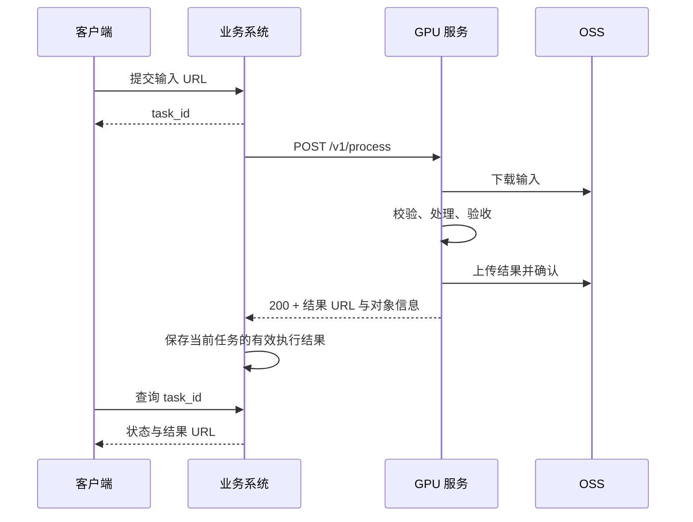

# 无状态视频去字幕服务设计

日期：2026-11-02。状态：设计草案，待用户审阅；尚未实现。

## 1. 目标与已确认的边界

将当前视频处理能力封装为内部 GPU 服务：接收一个可直接下载的 OSS HTTPS 视频 URL，完成下载、去字幕、成片验收和 OSS 上传后，在同一个 HTTP 请求中返回结果 URL。

用户已确认：

- 客户端使用异步任务：提交后获得 `task_id`，随后查询状态与结果。
- 现有业务系统负责该异步任务的状态、排队、调度、重试和查询。
- Python GPU 服务采用无状态模式，执行一次处理并同步返回结果。
- 输入 URL 已公开或自带签名，下载不需要服务端获取输入 OSS 凭证。
- 每个服务实例通过可配置的 slots 限制并发，默认 `3`；槽满后由业务系统稍后重试。

模型、模型缓存、执行中的请求和临时文件可以存在于实例内。实例重启后不恢复任务，调用方负责识别失败与重新调度。业务任务成功的依据是业务系统收到并保存成功响应；服务内部处理完成不等于调用方已经获知结果。

首版成功标准：调用方能够完成“异步提交 → 调用 GPU 服务 → 保存结果 → 查询结果”的链路；GPU 服务复用模型、拒绝超额请求、识别阶段失败，并且连续请求之间不串数据。上线验收需在目标 GPU 完成，已有合成实验不能替代服务容量测试。

## 2. 架构选择

采用外部业务系统编排、GPU 服务同步执行的方案。相比 Python 服务自建任务表与队列，这一方案复用既有业务基础设施；相比完全托管的任务平台，它可以直接部署到当前 GPU 机器。



Python 服务不维护业务任务表，不提供任务提交、进度查询或取消接口，不依赖 Redis、数据库或持久消息队列。它也不保证请求跨实例重启继续执行。

### 2.1 实例内进程划分

每张 GPU 部署一个服务实例，包含一个轻量 API 主进程和由 slots 配置确定数量的常驻模型子进程。默认 `3` 个 slot，每个 slot 对应一个独立模型子进程和一个 Pipeline，同一实例的进程使用绑定的同一张 GPU：

- API 主进程负责鉴权、请求校验、slot 分配、超时监督、健康检查和响应。
- 每个模型子进程一次执行一个请求，顺序完成下载、校验、Pipeline 处理、验收和上传；各请求在该进程内复用同一个 Pipeline。不同 slot 可同时工作，不共享 Pipeline 对象或请求数据。
- 主进程不导入或初始化 CUDA/Paddle 模型；子进程通过全新进程启动，避免继承 CUDA 上下文。
- 主进程与每个模型子进程分别通过专用 IPC 通道发送请求、结果及阶段消息，消息关联 `slot_id`、工作进程代次和 `execution_id`，拒绝旧进程迟到的结果；现有流水线 stdout 只进入日志，不能作为 IPC 协议。
- 不在 HTTP 事件循环中执行阻塞推理，也不以线程超时冒充已经终止 GPU 工作。

该进程边界用于硬超时和故障恢复。正常请求复用子进程；超时、OOM 或进程内 CUDA 故障后只终止并重建对应 slot 的子进程，其他健康 slot 继续执行。若驱动或设备故障影响整张 GPU，则将实例标记为未就绪并恢复受影响的所有 slot。不让每个任务重新启动 CLI。

各 slot 会持有独立的 OCR/STTN 模型、CUDA 上下文和缓存，GDINO 按每个 slot 的处理阶段加载与释放；因此 slots 限制的是在途请求数，不保证 GPU 吞吐按数量倍增。默认 `3` 是用户选择的准入配置，三并发显存、CPU、磁盘预算和实际吞吐仍需用真实服务负载验收。

### 2.2 Slots、准入与健康

`VSR_SLOTS` 配置每个实例的并发上限，默认 `3`，启动参数 `--slots N` 可覆盖环境变量；仅接受正整数。配置在启动时固定，调整后重启实例，不做请求级覆盖或运行中自动扩缩容。设为 `1` 时回到顺序处理模式。

主进程原子领取一个已就绪的空闲 slot 后才接受请求，绑定关系持续到该请求清理结束。下载、校验、处理、验收、上传、阶段内重试和客户端断连后的执行均占用同一个 slot；任一 slot 同时最多执行一个请求，实例在途执行数不得超过配置值。slot 正在初始化、重建或退出时不能分配新请求，也不能额外启动临时模型进程补位。

没有空闲 slot 且仍有正常运行的 slot 时，立即返回 `503 SERVICE_BUSY` 和 `Retry-After: 5`；没有可用的健康 slot 或实例正在退出时返回 `503 SERVICE_NOT_READY`。不在进程内排队，也不等待信号量腾出空位后才开始执行。

该上限只对一个实例有效，部署必须使用一个 API 进程，不能通过多个 Uvicorn worker 绕过 slots。默认三个 slot 均健康空闲时，前三个重叠请求分别进入三个进程；第四个返回繁忙。多实例上限为各实例 slots 之和，业务调度器负责整体准入。

- `GET /livez`：API 监督逻辑能响应则返回 200。
- `GET /readyz`：实例允许准入且至少有一个健康 slot 完成初始化与预热时返回 200；全部初始化、恢复或实例退出中返回 503。部分 slot 故障时，其余健康 slot 继续服务。
- 正在正常处理请求的 slot 仍视为健康；所有健康 slot 均占用时实例保持就绪并显示 `busy: true`，满载不代表模型故障。
- 健康响应提供 `slots_total`、`slots_available`、`slots_busy`、`slots_unavailable`，四者满足 `total = available + busy + unavailable`；初始化、恢复、退出中的 slot 计入 unavailable。每个 slot 同时报告 `slot_id` 和 `starting / idle / busy / recovering / draining / stopped` 状态。请求失败后执行尚未停止时继续保留分配关系，不能复用该 slot。

默认三个 slot 均已预热、两个正在处理时的健康响应包含：

```json
{
  "slots_total": 3,
  "slots_available": 1,
  "slots_busy": 2,
  "slots_unavailable": 0,
  "busy": false
}
```

多卡扩容采用多个独立实例。业务调度器限制在途请求，并对繁忙响应退避重试；普通负载均衡无法单独保证任务总能命中空闲 GPU。

## 3. 接口约定

### 3.1 请求

```http
POST /v1/process
Authorization: Bearer <service-token>
Content-Type: application/json
```

```json
{
  "request_id": "business-task-123-attempt-1",
  "input_url": "https://example.oss-cn-hangzhou.aliyuncs.com/input.mp4?...",
  "region": null,
  "remove_stickers": true
}
```

- `request_id` 必填，由业务系统生成，用于关联本次执行；长度 1–128，字符限 ASCII 字母、数字、`-`、`_` 和 `.`。
- `input_url` 必填，只接受 HTTPS；完整签名查询串只用于下载，不写入日志和错误响应。
- `region` 可省略或为 `null`，沿用当前自动推断字幕带、失败后回退全屏的行为；显式指定时为 `[ymin, ymax, xmin, xmax]` 整数数组，解码后再次检查边界。
- `remove_stickers` 默认 `true`，对应本地 GDINO；为 `false` 时只处理文字。
- 拒绝未知字段。首版固定 STTN，不开放模型路径、任意 FFmpeg 参数或实验优化开关。

`request_id` 是追踪标识，不是幂等保证。服务每次实际执行生成新的 `execution_id`，输出路径始终唯一。同一请求重复到达可能重复计算，业务系统负责抑制重复提交，并使用自己的执行版本防止旧结果覆盖新结果。

### 3.2 成功响应

仅在本地验收和 OSS 上传确认都通过后返回 `200`：

```json
{
  "request_id": "business-task-123-attempt-1",
  "execution_id": "7fd76d9bea224db691bd23782bc17ec84",
  "output_url": "https://example.oss-cn-hangzhou.aliyuncs.com/vsr/results/2026/11/02/7fd76d9bea224db691bd23782bc17ec84.mp4?...",
  "expires_at": "2026-11-02T17:00:00Z",
  "output": {
    "bucket": "example",
    "key": "vsr/results/2026/11/02/7fd76d9bea224db691bd23782bc17ec84.mp4",
    "size_bytes": 12345678,
    "etag": "example-etag"
  },
  "pipeline_version": "sttn-gdino-v1+build-id",
  "warnings": []
}
```

示例值不代表实际输出。返回 URL 便于立即使用，同时返回对象标识供业务系统保存与重新签名。签名 URL 的有效期不等于 OSS 对象保留期；业务系统后续查询时按对象 key 生成新 URL，不能长期复用过期签名。

### 3.3 失败响应

```json
{
  "request_id": "business-task-123-attempt-1",
  "execution_id": "7fd76d9bea224db691bd23782bc17ec84",
  "error": {
    "code": "DOWNLOAD_FAILED",
    "stage": "download",
    "message": "输入视频下载失败",
    "retryable": true
  }
}
```

准入前失败的 `execution_id` 为 `null`。统一处理 FastAPI 校验错误，不将框架默认错误体中的输入值或签名 URL 回显。

| HTTP 状态 | 错误码示例 | 调用方处理 |
| --- | --- | --- |
| 401 / 403 | `UNAUTHORIZED` / `URL_NOT_ALLOWED` | 修正认证或输入，不自动重试 |
| 413 | `INPUT_TOO_LARGE` | 更换输入或调整已验证的服务限制 |
| 422 | `INVALID_REQUEST` / `UNSUPPORTED_MEDIA` / `INPUT_INVALID` | 修正参数或视频 |
| 503 | `SERVICE_BUSY` / `SERVICE_NOT_READY` | 按 Retry-After 退避 |
| 502 | `DOWNLOAD_FAILED` / `DOWNLOAD_REJECTED` / `UPLOAD_FAILED` | 根据 retryable 判断；输入鉴权失败需检查权限并刷新 URL |
| 500 | `DETECTION_FAILED` / `PROCESSING_FAILED` / `OUTPUT_INVALID` | 检查具体错误，不无限重跑同一输入 |
| 503 | `WORKER_FAILED` / `GPU_UNAVAILABLE` / `RESOURCE_EXHAUSTED` | 实例恢复后有限重试；相同输入重复 OOM 需人工处理 |
| 504 | `PROCESSING_TIMEOUT` | 已终止本次执行；调整输入或处理预算后再试 |

网络异常或响应丢失时，调用方无法判断结果是否已上传；这与可明确返回的错误响应分别处理。`retryable` 是调度提示，不是保证下次会成功。

## 4. 一次请求的执行流程

1. API 验证身份、请求格式及服务状态，原子领取一个空闲 slot，生成 `execution_id` 并绑定到对应模型进程。
2. 在工作目录下按 slot 和 execution 创建独立目录，仅将服务端生成的 ID 用作路径。
3. 流式下载为 `input.part`，检查状态码、大小和期限，完成后改名为本地输入文件。
4. 检查媒体格式，完整扫描视频时间戳和帧数，记录输入音视频基线。
5. 调用常驻 Pipeline，输出仅写入本次请求目录。
6. 完整解码成片并对照输入基线验收；失败则不上传。
7. 上传唯一 OSS 对象，确认对象大小与上传结果，生成签名 URL。
8. 关闭媒体与文件句柄，清理本次目录，返回结构化结果并释放本次 slot；需要恢复模型时，该 slot 转为 recovering，恢复就绪后才可重新分配。

任一阶段失败都进入统一收尾；只能在执行已停止、资源不再使用后删除目录或释放分配关系。清理失败需记录告警并检查实例共享磁盘预算，不能掩盖原始错误；空间不足时实例停止准入并转为未就绪，保留其他在途执行的收尾资源。

## 5. 下载与 OSS 输出

### 5.1 输入下载

- 通过 HTTP 客户端流式写磁盘，不把完整视频读入内存。
- 配置可信 OSS 域名白名单；精确匹配域名，首版不接受重定向，避免跳转到未授权地址。
- 仅允许标准 HTTPS 端口，拒绝 URL 用户信息、IP 字面地址及解析到环回、私网、链路本地、保留网段的目标。部署网络同时限制到可信 OSS 出口，避免单靠应用 DNS 检查承担出网隔离。
- 不将远端 URL 传给 FFmpeg。日志记录 host 与受控标识，去掉查询串和认证信息。
- 校验 Content-Length（存在时）及实际累计字节；缺少长度头时仍实施字节上限。下载中断不得把部分文件交给 Pipeline。
- 连接超时默认 10 秒、单次读取空闲超时 30 秒，下载总预算默认 300 秒；总预算覆盖所有下载重试。
- 对临时网络故障和 429/5xx 最多尝试 3 次，每次重新下载，避免隐含断点续传一致性要求。403/404 不盲目重试；OSS 403 统一提示检查 URL 签名和访问权限，不断言一定过期。

业务系统在实际调度前准备下载 URL，其有效期需覆盖下载预算。服务收到后立即尝试下载，无需覆盖整段 GPU 处理时间。

### 5.2 输出上传

首版采用阿里云 OSS SDK，输出 endpoint、bucket、允许写入的 prefix 和凭证由部署配置提供，调用方不能选择任意存储目标。优先使用实例角色或可刷新的 STS 凭证；开发环境允许环境变量凭证，不写入仓库、请求体或日志。

- 输出对象默认私有，key 为 `<prefix>/YYYY/MM/DD/<execution_id>.mp4`，不从输入文件名或 `request_id` 拼接。
- SDK 流式上传，启用传输完整性校验；大文件使用分片上传，失败时中止已知的分片会话。OSS 配置清理未完成分片的生命周期规则，覆盖实例崩溃情形。
- 上传响应成功后 HEAD 对象并核对大小；ETag 作为对象元数据返回，不将分片 ETag 当作文件 MD5。
- 在同一请求内对临时上传故障最多尝试 3 次，总上传预算默认 300 秒，重试复用已验收的本地输出，不重新跑 GPU。
- 签名 GET URL 默认有效 3600 秒；若临时凭证剩余有效期不足，刷新凭证或缩短 URL 有效期，并按实际可用期限返回 `expires_at`。

若已经上传但响应丢失，OSS 中可能保留未被业务系统引用的对象。每次重试使用独立 key，不覆盖既有对象。首版不提供跨请求结果恢复或去重存储；结果 prefix 使用部署时必须显式配置的保留期，所有结果统一到期清理。业务系统如需更长保留，应在到期前复制到业务正式存储。后续可另做引用感知的清理器。

## 6. 媒体边界与验收

以下为首版建议默认限制，可通过配置收紧；放宽需在目标 GPU 验证资源预算：输入最大 1 GiB、时长 600 秒、帧率 60 fps、总帧数 36000、像素数 1920×1080、长边 1920、短边 1080，兼容同规格竖屏。元数据估算不足以放行，解码扫描中也检查实际帧数、尺寸和时间。

首版支持 MP4/MOV 容器中的单路 H.264、8 位 SDR、yuv420p、方形像素、无旋转变换的视频，以及最多一个可解码音轨。拒绝损坏视频、多视频轨、多音轨、HDR、交错扫描、奇数宽高及存在分辨率变化的流，避免隐式丢轨、编码失败或颜色变换。非零或无法识别的旋转矩阵也拒绝。输入无音轨时正常处理。

当前 Pipeline 按平均帧率重新生成视频 PTS。首版仅接受时间戳单调、等间隔的 CFR 输入：完整解码确认每帧间隔与名义帧周期之差不超过输入流一个 time_base tick；首个视频帧距零点不超过一个帧周期，首个有效音频采样距零点不超过 100 ms。音频基线扣除容器声明的编码延迟和 padding。VFR、时间戳缺失/倒退或超出上述起点范围的输入返回 `UNSUPPORTED_MEDIA`，不静默转换为 CFR。支持这些格式属于后续媒体规范化工作。

成片验收需要：

- 可完整解码，视频帧数与输入扫描一致，尺寸和帧周期符合预期。
- 输出为 MP4/H.264，帧时间戳单调，无空输出或截断尾帧。
- 视频时间跨度与输入差值不超过一个视频帧周期。
- 输入有音频则输出存在可解码 AAC 音轨；输入无音频则输出也无音频。
- 音频起点和结束边界相对输入的偏差不超过 100 ms，音视频相对偏移的变化不超过 100 ms；允许保留输入原有且在支持范围内的时长差。

这些检查验证媒体完整性，不能证明字幕已全部消失或没有误擦。画质沿用已接受的 STTN 基线，真实样片仍需人工验收。完整输入扫描和输出解码都计入服务耗时，不能从性能结果中排除。

## 7. Pipeline 复用与语义

新入口使用固定、可版本化的 `sttn-gdino-v1` 配置：STTN CUDA FP16、生产默认融合 QKV、首层 QKV 缓存、批量后处理、CUDA uint8 回传、立即有限值检查、完整最后一层；不启用此前未接入生产的实验路径。GDINO 沿用已验证的本地模型、阈值 0.22、最大面积 1000 px² 和 batch size 4。关闭 ProPainter 补修及最终残留统计，关闭白字复核、模板与时序字形实验；关闭残留统计不代表已经验证无残留。

部署版本记录代码构建标识、模型校验值和配置摘要，任何影响输出的变更都更新 `pipeline_version`。配置在实例启动时冻结，不允许请求修改全局模型状态。

- 每个 slot 的子进程启动时完成 OCR 初始化、模型文件与 FFmpeg 检查，加载并预热 STTN。GDINO 启动时检查本地加载与推理能力，随后按原策略释放，不将其改为常驻。模型初始化和预热由主进程逐个调度，避免三个进程同时冷启动；每个 slot 通过预热后独立提供容量，未就绪的 slot 不计为可分配容量。
- 保留现有段间 GC / CUDA 缓存清理。每次请求生成独立的字幕轨迹、遮罩、合成缓冲和统计，不保留上一视频数据。
- 通过明确的可选严格模式和结构化报告传递 GDINO 异常、未成功完成的检测及各模型精度状态；不在生产服务中复制基准用的全局函数替换。
- `remove_stickers=true` 时，GDINO 初始化失败、检测异常被捕获或跟踪统计 `model_failed > 0` 均返回 `DETECTION_FAILED`。零检测命中可以是正常结果，已成功逐帧重试的 batch 回退也不算漏做检测。
- FP16 按现有规则回退到 FP32 且完成处理时允许返回成功，附带模型对应的精度回退 warning，不能将其伪装成始终 FP16。STTN 回退后将对应 slot 转为 recovering，在下一请求前重建并预热其 STTN 引擎，失败则重建该子进程，避免精度状态跨请求悄然延续；其他 slot 不受该状态变化影响。
- OOM、CUDA 执行故障或未恢复的非有限输出不作为成功；恢复前保持未就绪。资源打开与 FFmpeg 子进程必须通过 finally/context manager 收尾。
- Pipeline 内未分类异常返回后重建对应 slot 的子进程；已明确为下载、输入校验或上传阶段的常规失败可在完成清理后继续复用该健康进程。IPC 异常视为对应工作进程故障，不能把协议半包或旧结果交给下一请求。

精度回退 warning 使用对象字段 `code: PRECISION_FALLBACK`、`model: sttn|gdino`、`requested: fp16` 和 `actual: fp32`。某个 slot 启动预热若发生精度回退，该 slot 不标记为就绪，报告初始化失败，避免从第一条请求起便处于未知精度状态。

现有 CLI 和旧 `service/server.py` 的接口保持独立。新入口放在独立模块和启动命令下，避免静默更改旧 `/tasks` 行为；旧服务不是新架构的部署入口。

## 8. 超时、断连与退出

单请求总执行预算默认 3600 秒，下载、校验、处理、验收、上传和重试共用该绝对截止时间；阶段预算只能进一步收紧，不能相加绕过总预算。处理阶段默认最多 3000 秒。主进程使用单调时钟监督，子进程收到相同截止时间。

- 达到某个请求的硬超时，主进程只终止其 slot 的子进程及其 FFmpeg 等后代进程，最多等待 5 秒后强制终止，回收进程后返回 504，并为该 slot 启动新子进程。
- 仅在确认旧执行已终止后清理其目录。对应 slot 在模型恢复和预热完成前不能接新请求，其他健康 slot 保持服务。
- 客户端断连时，当前处理继续执行至完成或总截止时间，对应 slot 一直占用；不依赖 HTTP 协程取消来释放槽。完成后清理并记录结果对象信息，响应无法保证送达。
- 业务系统若对断连重试，必须接受可能重复计算，保持每次执行隔离并只采纳当前有效尝试。该服务不承诺 exactly-once。
- 收到 SIGTERM 时先停止所有 slot 的准入，允许当前在途请求在共同的退出宽限期内结束；超过宽限期按硬超时方式终止各工作进程组，不对每个 slot 依次追加一轮宽限期。
- 容器整体异常退出时，由业务系统重试。启动时清理专属临时卷中的遗留目录；临时卷不能在多个实例之间共享。

每个工作进程初始化与预热预算默认 600 秒，从主进程实际允许该 slot 开始初始化时计时，不包含等待其他 slot 预热的时间。初始化失败或工作进程异常退出后，各 slot 独立按 1、2、4、8、16、30 秒的上限退避重建，并由主进程串行安排模型初始化；该 slot 保持不可用并记录恢复失败，避免循环快速加载模型。恢复成功后清零其连续失败次数。恢复时旧进程必须已经退出，slot 数及模型进程数不因重建临时超过配置。退出宽限期默认 3660 秒，部署平台的终止宽限期也必须覆盖该配置。

生产部署需要整条 HTTP 链路支持长请求。按默认总预算，业务调用、代理和服务器配置应允许至少 3660 秒的等待与无响应读取，正常情况下不自动重试 POST。若现有网关无法支持这一时间，应使用可配置的内部直连链路，不能仅调大 Python 超时并认为问题已解决。

## 9. 模块边界与部署

建议按职责划分，具体文件可在实现计划中合并小模块：

| 模块 | 对外能力 | 主要依赖 |
| --- | --- | --- |
| API 与协议 | 校验请求、映射响应、鉴权和健康接口 | FastAPI、配置、监督器 |
| 监督器与 slot 池 | 原子分配 slots、子进程启动/恢复、IPC、逐请求硬截止时间 | 标准库进程与信号 |
| 常驻执行器 | 在单个 slot 内顺序执行完整操作、独立持有 Pipeline | Pipeline、下载、媒体、存储 |
| 下载器 | 安全流式下载到指定本地路径 | HTTP 客户端、出口配置 |
| 媒体验收 | 生成输入基线、检查支持格式、验收成片 | PyAV、FFmpeg |
| OSS 适配器 | 上传本地文件、确认对象、生成带期限 URL | OSS SDK、凭证提供器 |

首版目标为 Linux/NVIDIA CUDA。新增服务专用依赖清单与容器入口，固定 GPU 环境中验证过的依赖版本，显式安装 Linux FFmpeg/ffprobe，不沿用旧镜像的 CLI 入口或 macOS 二进制回退。模型预先放入镜像或只读模型卷，启动和请求期间不从模型站点下载权重。

启动必须验证：服务认证配置、正整数 slots、输入域名白名单、输出 OSS bucket/prefix 与凭证提供器、结果保留期、临时卷容量、CUDA 可用、模型可加载、FFmpeg 可执行。缺少必填配置或 slots 非法时启动失败。每个 slot 的 CPU 线程数通过独立配置 `VSR_THREADS_PER_SLOT` 控制，默认 `1`，同时限制 PyTorch、OCR 与编解码线程预算，避免三进程各自占满 CPU；增加线程数同样纳入负载测试。

工作卷准入预算暂按每 slot 至少 10 GiB 空闲预留，默认三个 slot 至少 30 GiB，这是待真实成片大小验证的部署初值。slot 领取时由主进程原子预留磁盘预算，不能让多个进程对同一份可用空间重复放行；持续监测输入、输出与中间文件的实际使用，超过预留预算时在剩余空间内申请增量，空间不足则停止准入并让对应请求按资源错误收尾。必须保留正在运行的其他 slot 的预留和清理空间。

记录结构化日志：request_id、execution_id、slot_id、工作进程代次、pipeline_version、当前阶段、各阶段 wall time、输入/输出字节与帧数、实际精度与回退、worker 重启、失败码。至少提供请求成功/失败/繁忙计数、阶段耗时、slots 总数/空闲/占用/不可用、worker 恢复次数和临时卷空间指标。首版不启用 torch.profiler/CUDA Events；细粒度 GPU 时间仍使用现有离线基准。

## 10. 验证与交付边界

自动化测试围绕可观察行为：

1. 请求和鉴权校验，未知字段、错误 ROI、URL 限制，错误体与日志不泄露签名。
2. 默认 slots 为 3，支持配置为 1 和其他正整数，非法值启动失败；并发竞争最多放行 slots 个请求。三个 slot 都健康空闲时，前三个重叠请求能进入各自进程，第四个立即返回繁忙；下载、推理、上传和清理期间均保持 slot 占用，不出现隐藏等待队列。
3. 下载中断、缺少长度头、超限、重定向、403/404、超时及有限重试。
4. 上传失败仅重试上传，HEAD 不一致不成功；对象 key 独立、URL 期限正确、失败分片可清理。
5. 媒体样本覆盖无音频、音频保留、CFR、VFR 拒绝、旋转/损坏/超限输入、输出截断与音频偏移。
6. 同一 slot 的连续请求与不同 slot 的并发请求均隔离；GDINO 静默降级变成失败，FP32 回退可见且该 slot 下一请求恢复初始状态。
7. 在独立真实进程中验证单个 worker 崩溃、卡住、硬超时和客户端断连；确认该 slot 的后代进程退出、旧结果被丢弃、其他 slot 请求仍能完成、健康接口与容量计数正确。SIGTERM 停止所有 slot 准入并在共同期限内退出；多个进程不能重复领取同一份磁盘预算。

本地以替身 Pipeline、存储适配器及受控媒体文件验证服务契约；不要求开发机有 CUDA 或真实 OSS 权限。目标环境再完成真实 OSS 下载上传、STTN/GDINO 预热、不同视频连续处理、重启与网络故障演练，核对音视频和人工画质。

目标 GPU 性能验收包含下载、输入扫描、处理、成片验收和上传，对照 slots=1、2、3，分别记录冷启动、预热后单请求时延、整体吞吐、整卡显存峰值、CPU/RAM 和磁盘使用，不能相加单进程峰值代替整卡测量。默认三并发覆盖修复、GDINO 加载及 FP32 回退与其他 slot 计算重叠的资源峰值，并检查输出与顺序执行基线一致。测试业务分布中的最大输入，在 slots=3 下至少完成 20 条混合素材观察内存与磁盘是否持续增长。容量和限制仅在该验收后认定；默认值保持用户选择的 3，若目标机器不足则由部署者显式调低，不静默降低 slots。已有 Pipeline 复用基准的约 19.48% 摊销节省作为方向性证据，不写成服务加速承诺。

本次交付范围包含 Python 无状态服务、默认三并发的可配置 slot 池、独立常驻模型进程、调用文档、部署样例、必要的 Pipeline 严格报告与资源收尾、自动化测试。业务系统侧的任务表/调度器改造、跨请求去重与恢复、任意媒体规范化、跨视频模型批处理、运行中动态调整 slots、模型新优化不在首版内。

## 11. 审阅要点

已确认的核心是业务系统异步、GPU 接口同步、输入直链、实例无业务持久状态，以及通过 slots 配置服务并发、默认 3。本草案另外提出的首版设计包括：每个 slot 一个独立常驻模型进程、固定 STTN/GDINO、服务配置输出 OSS、私有签名结果、严格媒体支持范围、3600 秒总预算和断连后继续执行。这些约定作为完整方案提交审阅，尚不表示用户已逐项确认。

设计批准后再制定实现计划；本文件不代表服务已实现、已部署或已完成真实 GPU/OSS 验收。
